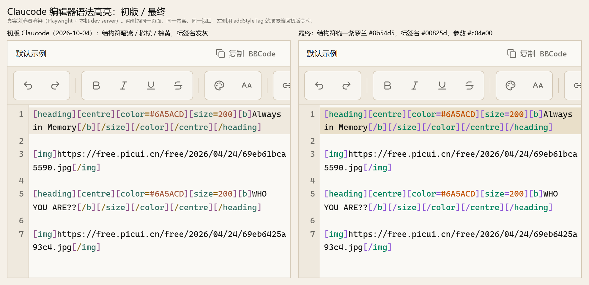
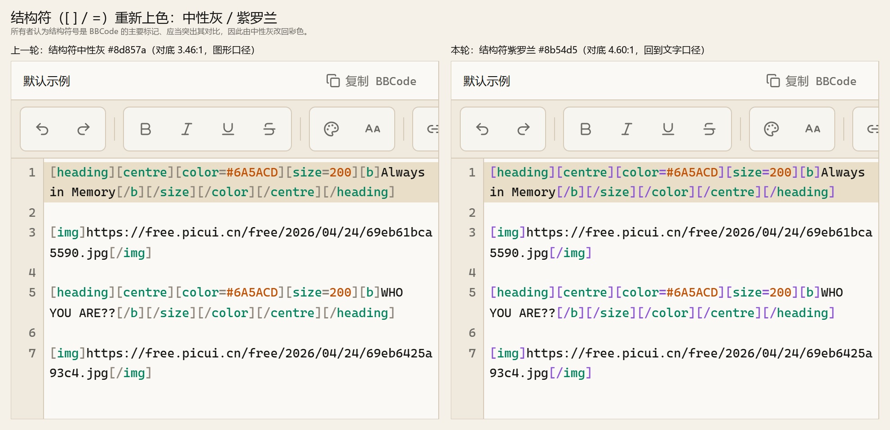
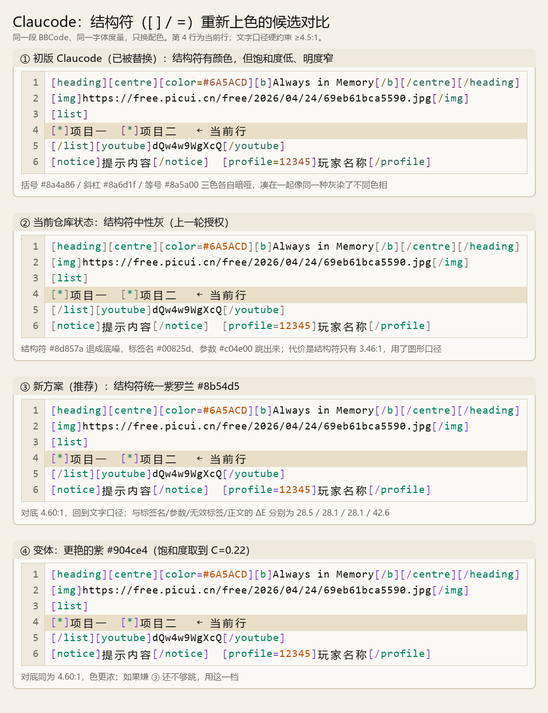
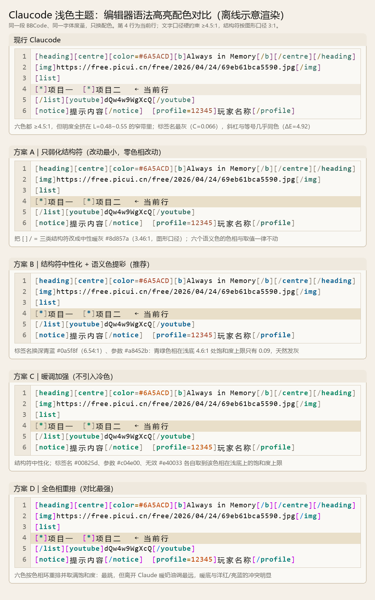

# Claucode 编辑器语法高亮修复证据（2026-10-10）

## 来源与范围

- 触发：项目所有者反馈"注意到当前项目的claucode主题会使编辑器的配色变得不突出，极度影响编辑的视觉体验"，要求给出建议与修复方法。
- 同一主题下经过两次授权，本文件按时间顺序记录，**最终取值以"最终取值"一节为准**：
  1. 所有者看过五个候选方案的并排渲染后选择 `方案 C｜暖调加强（不引入冷色）`，配套修复只勾选"当前行底色加深为 `#e9dfc9`"。
  2. 所有者随后追加要求"给 [ ] / = 结构符号加色吧，我觉得这个比较主要，应该突出其对比"，把已经落地的中性灰结构符改回彩色。
- 授权记录见[兼容性说明 §6.4](../../compatibility.md#64-预览配色裁决与块级外边距待决项2026-09-25)。
- 全部截图均为本项目本地渲染，未访问任何站外服务：`palette-comparison.png` 与 `structural-candidates.png` 是离线绘制（Pillow，示意渲染，用于方案选型）；其余为真实浏览器渲染（Playwright + 本机 `127.0.0.1:4173` 的 dev server）。
- 截图内容是应用首次访问自动创建的默认示例模板，与所有者反馈截图同源；不涉及真实站外图床。

## 问题与量化依据

复算脚本 `palette-measure.mjs`（零依赖 Node，直接运行）给出三条结论：

1. **明度被挤在窄带里**：初版六色的 OKLCh 明度全部落在 `L=0.484~0.549`（跨度 `0.065`），平均饱和度 `0.111`，眼睛读到的是同一种灰染了不同色相。
2. **高亮比正文更淡**：编辑器底 `#faf9f5` 上，正文 `#141413` 是 `17.50:1`，而六个语法色只有 `4.65:1~5.88:1`。Darkode 下恰好相反（正文 `13.14:1`，语法色大多比正文更亮），所以"跳"只发生在深色主题——这是浅色主题的结构性问题，不是取色失误。
3. **关键语义饱和度最低**：标签名 `--syntax-tag` 的饱和度只有 `0.066`（几乎无色），斜杠与等号的 OKLab ΔE 仅 `4.92`（Darkode 同位置为 `8.49`）。原因是 sRGB 色域限制：`#faf9f5` 上取 `4.6:1` 时，青绿（`180°`）可达饱和度上限只有 `0.098`，紫（`315°`）可达 `0.291`。

初版的问题**不是"有颜色"本身，而是六个颜色明度相近、饱和度偏低**——因此把结构符重新上色时不能简单回到初版取值。

## 最终取值

| 令牌 | 初版（2026-10-04） | 中性灰（一度采用，已推翻） | 最终 | 对编辑器底实测 | 说明 |
| --- | --- | --- | --- | --- | --- |
| `--syntax-bracket` | `#8a4a86` | `#8d857a` | `#8b54d5` | `4.60:1` | 结构符，统一取紫罗兰 |
| `--syntax-slash` | `#8a6d1f` | `#8d857a` | `#8b54d5` | `4.60:1` | 同上，与括号同值 |
| `--syntax-equals` | `#8a5a00` | `#8d857a` | `#8b54d5` | `4.60:1` | 同上，与括号同值 |
| `--syntax-tag` | `#2f6b5f` | `#00825d` | `#00825d` | `4.58:1` | 饱和度 `0.066 → 0.113` |
| `--syntax-parameter` | `#a05236` | `#c04e00` | `#c04e00` | `4.60:1` | 饱和度 `0.111 → 0.162` |
| `--syntax-invalid` | `#b93b3b` | `#e40033` | `#e40033` | `4.59:1` | 饱和度 `0.162 → 0.234` |
| `--editor-active-line` | `#efe9de` | `#e9dfc9` | `#e9dfc9` | `1.26:1` | 初版只有 `1.15:1`，当前行实际看不出来；正文在其上仍有 `13.92:1` |





- **口径**：三个结构符改为彩色后不再需要"图形口径"这一例外，六个语法色**全部满足文字级 `4.5:1`**。
- **色相骨架**：暖调（青绿、橙红、红）加紫罗兰，**未引入蓝/青等冷色**；Darkode 侧一色未改，`:root` 兜底副本与令牌集合未动。
- **未列入本次授权、保持现状**：`--shell-gutter-active`（行号栏当前行，仍为 `#e8e0d2`，对行号栏底 `1.085:1`）、标签名字重、编辑器底色改纯白。

## 结构符为什么取紫罗兰

在 `#faf9f5` 上固定色相与饱和度、二分到恰好 `4.6:1` 的明度后比较区分度（详见 `palette-measure.mjs` 输出与 `structural-candidates.png`）：

- 紫罗兰（`300°`）与其余四色（标签名、参数、无效标签、正文）的 ΔE 分别为 `28.5 / 28.1 / 28.1 / 42.6`，六个语法色互不混淆。
- 品红（`335°`）与参数、无效标签同属红系，在 `C=0.14~0.22` 各档的最小 ΔE 只有 `17.3~18.2`（同档紫罗兰为 `23.7~29.8`），未采用。
- 饱和度取 `C=0.19` 时恰为 `#8b54d5`（对底 `4.60:1`）。嫌不够跳可在同色相取 `C=0.22` 得到 `#904ce4`（对底同为 `4.60:1`），只换一个取值即可——`structural-candidates.png` 的第 ③、④ 格就是这两档。



结构符三类共用同一个值：它们是一类视觉元素，同一行里出现两个近似色反而会互相干扰。`palette-comparison.png` 是更早的五方案选型渲染（其中"方案 C"一栏的结构符仍是当时的中性灰取值）。



## 最终复核结果

- 按顺序执行六条固定命令，全部通过：`format:check`、`lint`、`typecheck`、`test`（17 个文件、113 条用例）、`build`、`test:e2e`（97 条用例）。
- `docs:check` 通过：15 个 Markdown 文件、本地链接（含锚点）与 4 个外部链接（未联网校验）。
- 新增 `tests/unit/theme-tokens.test.ts`：锁定两个主题块的令牌集合完全一致、主题块覆盖 `:root` 除排版尺寸类之外的全部令牌、Claucode 与 Darkode 的编辑器取值、六个语法色全部 ≥ `4.5:1`、三类结构符同值且不与语义色重复、当前行底色 ≥ `1.2:1` 且正文在其上 ≥ `4.5:1`。文档 §1.1 一直声称该断言存在，此前仓库里并没有，本次补上。
- 真实浏览器复核（`capture-editor.mjs`）：三个状态由同一页面就地覆盖令牌得到，浏览器读回的值分别是 `#8b54d5`（仓库当前）、`#8d857a`（中性灰版）、`#8a4a86`（初版），确认覆盖生效、对比成立。
- 构建仍有既有的主包超过 `500kB` 提示，不影响构建成功，未扩大范围处理。
- 未安装依赖、未下载浏览器、未禁用任何安全检查、未访问真实站外服务；本地服务仅监听 `127.0.0.1`。

## 本轮修改文件

- `src/app/theme.css`：`[data-theme='claucode']` 块内六个 `--syntax-*` 与 `--editor-active-line` 换值，并写明两次修订的依据。
- `tests/unit/theme-tokens.test.ts`：新增主题令牌与编辑器配色的回归断言。
- `docs/theme.md`：§2.6 令牌表与修订说明、§6 对比度证据与被推翻取值的存档。
- `docs/compatibility.md`：§6.4 追加本次授权记录与过程记录。
- 本证据目录：`README.md`、`editor-initial.png`、`editor-neutral-gray.png`、`editor-final-purple.png`、`editor-initial-vs-final.png`、`structural-neutral-vs-final.png`、`structural-candidates.png`、`palette-comparison.png`、`palette-measure.mjs`、`capture-editor.mjs`。

## 复跑方式

```bash
# 1. 复算对比度、饱和度、色相上限与结构符候选（零依赖，不联网）
node docs/evidence/claucode-syntax-2026-10-10/palette-measure.mjs

# 2. 复现编辑器截图：先起本机 dev server，再运行截图脚本
npm run dev -- --host 127.0.0.1 --port 4173
node docs/evidence/claucode-syntax-2026-10-10/capture-editor.mjs
```

`capture-editor.mjs` 只访问 `http://127.0.0.1:4173`，截图写到当前工作目录的 `.tmp/`。
